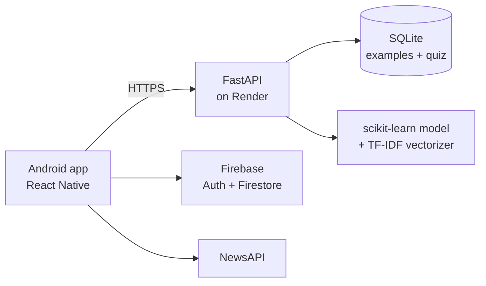

# PhishAware

A mobile app that teaches people to spot phishing, and checks suspicious SMS messages with machine learning.

- **Mobile app:** React Native (Android), Firebase Authentication and Firestore
- **API:** Python FastAPI, scikit-learn, sentence-transformers, SQLite, hosted on Render

## Features

| Feature | How it works |
|---|---|
| SMS analysis | The app sends a message to the API. A scikit-learn model (TF-IDF + link / email / phone features) returns a phishing risk score from 0 to 100 and the 5 most suspicious words. |
| Known-phishing lookup | The API compares a message with known phishing examples using sentence embeddings (`all-MiniLM-L6-v2`). |
| Quiz | Phishing questions in 3 levels, with an explanation for each answer. |
| News | Recent phishing news from NewsAPI. |
| Accounts | Sign-up and login with Firebase Authentication. |

## Architecture



## Repository structure

```text
phishaware/            React Native app (Android)
phishaware-backend/
  app/main.py          FastAPI app
  app/routes/          API endpoints
  app/services/        ML analysis and database lookup
  app/security.py      admin token check
  phishaware.db        seed data: 50 example messages and 17 quiz questions (no user data)
  start.sh             start script used by Render
```

## API endpoints

| Method | Path | Access |
|---|---|---|
| GET | `/` | public |
| POST | `/check-phishing/` | public |
| POST | `/ai-phishing-analysis/` | public (used by the app) |
| GET | `/quiz/questions?level=facile` | public (levels: `facile`, `moyen`, `difficile`) |
| POST | `/add-phishing/` | admin: `X-Admin-Token` header |
| POST | `/ai-phishing-analysis-openai/` | admin: `X-Admin-Token` header (each call costs OpenAI credits) |

## Run the API locally

```bash
cd phishaware-backend
pip install -r requirements.txt
cp phishaware.db /tmp/phishaware.db
export DATABASE_URL=sqlite:////tmp/phishaware.db
export ADMIN_TOKEN=change-me      # optional: enables the admin endpoints
export API_KEY=sk-...             # optional: OpenAI key for the OpenAI endpoint
cd app && uvicorn main:app --reload
```

Open http://127.0.0.1:8000/docs to try the endpoints.

## Try the app

1. Install Android Studio with an Android emulator.
2. [Download the APK](https://drive.google.com/drive/folders/1cDkYvHJCbexPhknRv6koM1ftxF7YqWip?usp=drive_link) and drag it onto the emulator.
3. The app needs internet access to reach the API. The free Render server sleeps when nobody uses it, so the first call can take a few seconds.

To build the app yourself, see [`phishaware/README.md`](phishaware/README.md).

## Security and privacy notes

- The app asks for SMS permissions. New SMS are first checked on the phone with a keyword list. A message goes to the API only when you choose to analyze it.
- The OpenAI key, the NewsAPI key and the admin token come from environment variables and are not in the repository.
- `google-services.json` (Firebase config) is public by design. Its API key should be restricted to the app in the Google Cloud console.
- Write and paid endpoints need an admin token. Without `ADMIN_TOKEN` on the server, they are closed for everyone.

## Possible improvements

- [ ] Rate limiting on the public endpoints
- [ ] Move the NewsAPI call to the backend, so the key is not inside the APK
- [ ] Unit tests for the API and the model
